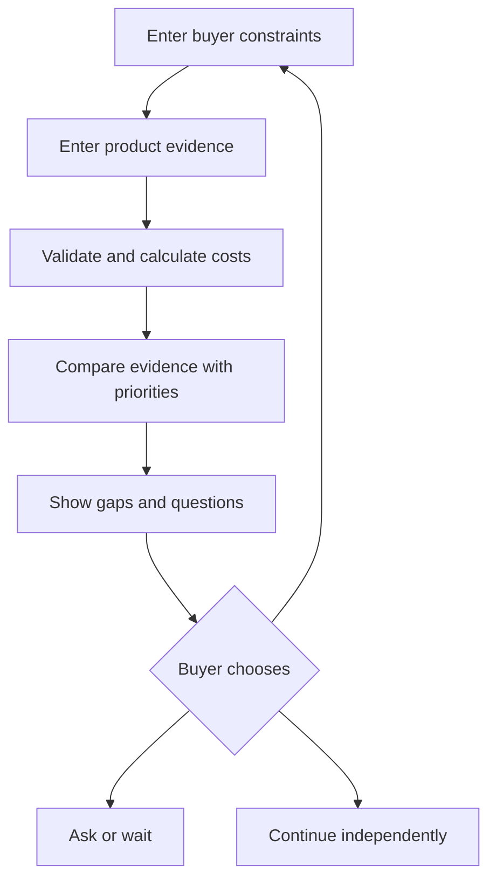
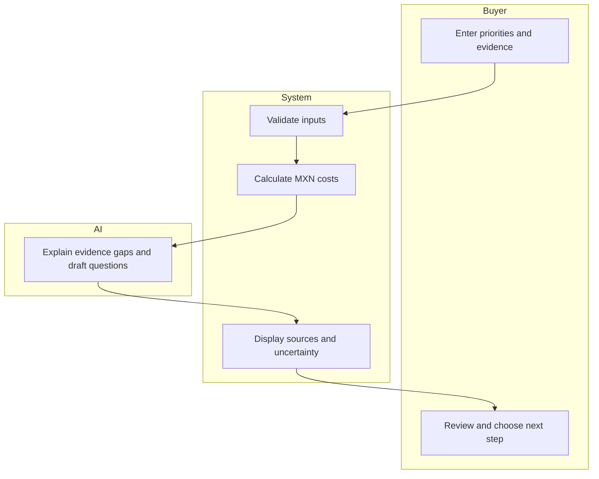

# PACKET — Week 10 — Valeria
# Antes de comprar

## Problem
A buyer may see “30-day returns” without knowing whether the
policy covers the failure she fears. This tool helps her compare
her own needs with the available purchase information.

## Exact user
A Mexican university student buying a school bag to carry a
laptop and one book. She has a limited budget and would not
pay for basic purchase advice.

## Success definition
Before the module closes, the buyer can enter her priorities,
budget, product price, shipping and return terms; review missing
information; copy clarification questions; and choose her next step.
Changing an input invalidates the previous review.

## Image-generated mockup
File: docs/mockup.png
The generated concept shows a buyer-constraints form beside an
evidence review. Add the image before application implementation.
The mockup is a design concept, not a working product screenshot.

## Feature flow

## Actor swimlane

## Benchmark line
The strongest researched benchmark for evidence-grounded consumer
assistance is Consumer Reports AskCR.
Source: https://www.consumerreports.org/askcr/

My slice localizes the experience to Spanish, MXN and a buyer-supplied
transaction, including missing return coverage and clarification
questions. It does not claim that AskCR tested this specific product.

## Three-year view
The product could become a buyer-owned workspace for purchase evidence.
Dated policy records could support reviews across Mexican retailers.
Independent funding, buyer control and a correction process would
remain necessary as the product grows.

## Scope cut
We are not building a store, seller recommendation engine,
automatic checkout, retailer certification or legal advice service.
We do not guarantee durability, fit, claim acceptance or refunds.
We do not collect body photos or store personal purchase histories.

## Architecture and stack
| Layer | Implementation |
|---|---|
| Interface | Responsive Spanish web page |
| User constraints | Budget, intended use and required protection |
| LLM | Explain gaps and draft questions from supplied evidence |
| Additional data | Structured product, shipping and return prices |
| Calculation | Deterministic MXN arithmetic, separate from AI |
| Privacy | Inputs remain in session; no personal-data database |
| Hosting | GitHub source and Vercel deployment |
| Secrets | Server-side environment variables only |

A simulated AI mode must be visibly labeled.
It must never claim to run a real LLM or read images.
Real LLM integration remains a separate acceptance requirement.

## Blueprint conditions
1. SHADOW CLAUSE: preserve the buyer’s priorities and final choice.
   Show reasons to wait or not buy. Never place an order.
2. Show the source, date and status of material findings.
   Missing evidence remains unverified.
3. Show total costs, relevant exclusions, return costs and claim route.
   Financial exposure must state its assumptions.
4. No affiliate links, sponsored rankings or paid favorable findings.
   Public retailer judgments would require human review and appeal.
5. Minimize data, validate inputs and keep secrets out of the repository.
   Use fictional, labeled demo data.
6. Evaluate understanding and fidelity to buyer priorities.
   Do not claim reduced regret, returns or spending without measurement.

## Security floor
- Never commit API keys or environment files.
- Validate text length, numerical ranges and request size.
- Treat policy text as untrusted evidence, not AI instructions.
- Render user input safely.
- Use fictional demo information.
- Do not persist personal data in this slice.
- If personal-data storage is added, implement authentication
  and per-user access controls before using it.

## Test plan
1. A 300-peso product plus 40-peso shipping totals 340 pesos.
2. A 300-peso budget flags a 40-peso overrun.
3. A zero return cost remains zero; a blank cost remains unknown.
4. “30-day returns” alone never confirms coverage for damage after use.
5. A claimed inclusion or exclusion requires a supporting quote.
6. Negative, non-finite and oversized inputs are rejected.
7. Instruction-like policy text cannot change the tool’s rules.
8. Editing an input invalidates the previous result.
9. Reset clears the session’s purchase information.
10. The buyer can ask, wait or continue without an automatic purchase.
11. Run and document the mechanical tests, fix a discovered bug,
    and redeploy.
12. In a fresh chat, test screenshots with a fictional student persona.
    Log confusion, fix the worst issue and retest.

## Development and submission evidence
- Commit this packet and mockup before application code.
- Write a precise implementation prompt with acceptance criteria.
- Make at least five meaningful commits and two deployments.
- Update DECISIONS.md at session close, record the next move,
  commit and push.
- Submit the live URL, GitHub link, demo video, packet PDF,
  persona-test PDF and full development conversation PDF.
- Preserve the complete conversation; a summary is not a transcript.